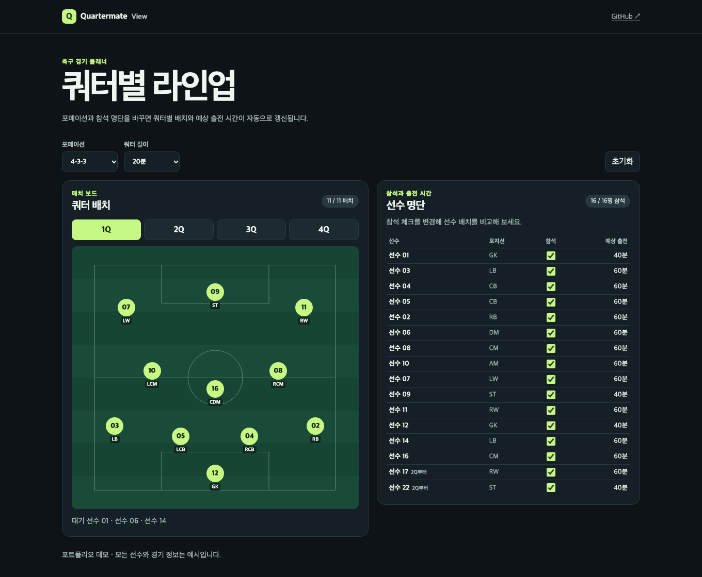

# Quartermate View

축구 경기의 쿼터별 출전 명단을 자동으로 만드는 Quartermate의 포트폴리오 데모입니다. 사회인 축구팀에서 참석 인원과 선호 포지션을 확인하며 매 쿼터 명단을 다시 짜야 하는 문제에서 출발했습니다.



- **포메이션**에서 11인제 `4-3-3`과 7인제 `2-3-1` 등을 바꿔 경기장 배치를 비교할 수 있습니다.
- **선수 명단**에서 참석 체크를 바꾸면 네 쿼터의 라인업과 선수별 예상 출전 시간이 다시 계산됩니다. 두 선수는 2쿼터부터 참여하도록 설정되어 있습니다.
- **쿼터 배치**에서 각 쿼터의 출전 선수, 빈 포지션, 대기 선수를 볼 수 있습니다. 쿼터 길이를 바꾸면 출전 시간이 갱신됩니다.

## 로컬 실행

Node.js 22.18 이상(22.x) 또는 24 이상이 필요합니다.

```sh
npm ci
npm run dev
```

터미널에 표시되는 주소를 브라우저에서 엽니다. `npm test`는 라인업 배정 테스트, `npm run build`는 타입 검사와 정적 빌드를 실행합니다.

## 구현

- [배정 엔진](src/engine/lineup-optimizer.ts)은 선수, 쿼터, 포지션을 최소 비용 최대 유량 그래프로 모델링합니다. 같은 선수는 한 쿼터에 한 자리만 맡을 수 있습니다.
- 먼저 채울 수 있는 자리를 최대한 채운 뒤, 출전 횟수가 고르게 분배되도록 비용을 매깁니다. 출전 횟수 기준에서 비용이 같을 때 포지션 적합도를 비교합니다.
- TypeScript와 Vite로 만든 정적 데모입니다. 번호로 표시한 합성 선수 데이터와 계획은 브라우저 메모리에서 처리되며 새로고침하면 초기화됩니다.

이 저장소는 포트폴리오 열람용으로 공개합니다. 프로젝트 코드에 별도의 오픈소스 라이선스를 부여하지 않았습니다.
